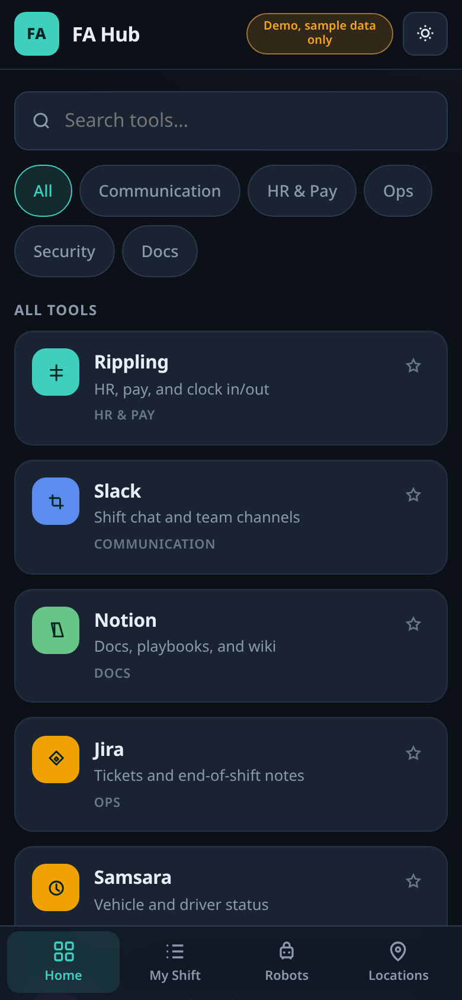
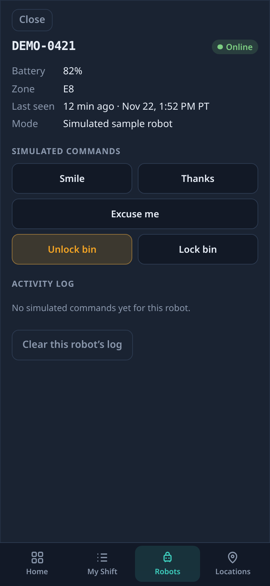
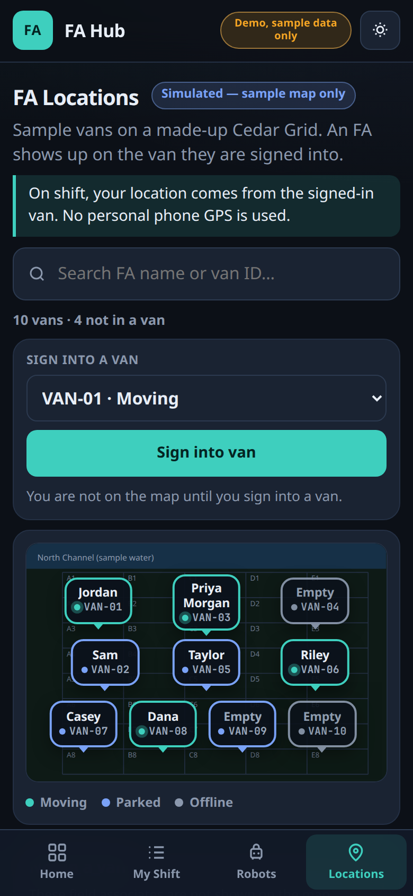

# FA Hub

## Live demo

**[https://ericlewis-code.github.io/fa-hub/](https://ericlewis-code.github.io/fa-hub/)**

GitHub Pages serves this repository from the `main` branch root, so the app is published at the `/fa-hub/` path. Phone screenshots of the sample-data demo:





A personal **phone app** (installable PWA) for field ops: one home screen for the tools a field operations associate bounces between on a shift. Built on personal time, with **fake sample data and placeholder links only**. It is not affiliated with, used by, or connected to any employer.

The header badge — **Demo, sample data only** — is there so anyone reviewing it can tell immediately.

## Run it locally

Service workers and “Add to Home Screen” need an `http://` or `https://` address. They will not register if you open the file directly (`file://`).

From this folder:

```bash
python3 -m http.server 8080
```

Or: `./serve.sh` (same thing, port 8080 by default; pass another port if you want, e.g. `./serve.sh 8765`).

Then open **http://127.0.0.1:8080/** in a browser. On a phone on the same network, use this computer’s local IP instead of `127.0.0.1` (and bind the server to `0.0.0.0` if needed: `python3 -m http.server 8080 --bind 0.0.0.0`).

To match the GitHub Pages subpath, serve a parent directory that contains this repo as `fa-hub/` and open **http://127.0.0.1:8080/fa-hub/**. Asset paths, the manifest `start_url` and `scope`, and the service worker registration all stay relative, so the same files work at `/` locally and at `/fa-hub/` on GitHub Pages.

Favorites, the daily shift checklist, recently opened tools, recently looked-up robots, the activity log, which van you are signed into, and any offline queue are saved in this browser’s `localStorage`.

Use the bottom tabs to move between **Home**, **My Shift**, **Robots**, and **Locations**. On the Robots tab you can jump straight to a sample unit with a hash like `#robots/DEMO-0421`.

## Install it on a phone

### iPhone (Safari)

1. Open the site in **Safari** (not Chrome).
2. Tap the **Share** button (square with an arrow).
3. Scroll and tap **Add to Home Screen**.
4. Confirm the name **FA Hub**, then tap **Add**.
5. Open it from the home screen. It runs standalone, like a regular app.

### Android (Chrome)

1. Open the site in **Chrome**.
2. Tap the menu (three dots) and choose **Install app** (sometimes **Add to Home screen**), or tap the install icon in the address bar if it appears.
3. Confirm, then open **FA Hub** from the home screen.

Once installed, the app caches its pages and icons so the launcher, shift checklist, robot lookup, and map still open when signal is poor. Van sign-in and robot commands made while offline are queued on the device and marked synced when you’re back online (this demo has no real server). The service worker cache name is versioned so an installed phone picks up a new copy after the cache version changes.

## Hosting

This repo is set up for **GitHub Pages** from the `main` branch, folder `/ (root)`. Enable Pages on that source if it is not already on. The public URL is [https://ericlewis-code.github.io/fa-hub/](https://ericlewis-code.github.io/fa-hub/). An empty `.nojekyll` file stops Jekyll from processing the site. Do not put any real company data in it.

`start_url`, `scope`, service worker registration, and the cache list use relative paths, so the PWA stays inside `/fa-hub/` on GitHub Pages and still works when you serve this folder by itself.

- **Netlify Drop:** Open [app.netlify.com/drop](https://app.netlify.com/drop) and drag this folder onto the page. You get a `*.netlify.app` URL with HTTPS, which PWAs need.

## What it includes

- **Launcher** — Searchable tiles for Rippling, Slack, Notion, Jira, Samsara, Driver Authenticator, Ramp, Google Meet, Gmail, Google Docs, Authenticator, Tailscale, plus in-demo Robot Commands and FA Locations. Category chips, favorites, and recently opened tools.
- **My Shift** — Start, mid, and end-of-shift checklist that persists on this device and resets each day.
- **Robot Commands** — A simulated fleet of 2,200 units (`DEMO-0001`–`DEMO-2200`). Search by full or partial ID, filter by status / battery / zone, sort, and page through results. The search bar stays sticky while you scroll. Selecting a robot opens a detail panel with simulated emote and bin commands: Smile, Thanks, Excuse me, Unlock bin, Lock bin. Unlock bin asks for confirmation. Commands only append a timestamped line to the on-screen activity log.
- **FA Locations** — An inline SVG of a made-up “Cedar Grid” area. Sample vans (`VAN-01`–`VAN-10`) each have a position on that map, a last-updated time, and a status of moving, parked, or offline. Pins are labeled with the field associates signed into that van. Tapping a van opens a card with the van ID, who is signed in, how long since the last update, and the status. Associates who are not in a van are listed under “Not in a van” and are not drawn on the map. Search filters by FA name or van ID. “Sign into van” / “Sign out” is a simulated control for you: it moves your pin onto that van, saves in `localStorage`, and works offline. Moving vans nudge every few seconds. While you are on shift, location comes from the signed-in van — no personal phone GPS is used.
- **Installable PWA** — `manifest.json`, 192×192 and 512×512 icons, and a service worker that caches the app for offline use. Offline check-ins and command-log entries are queued locally.

Placeholder links go to `https://example.com/...`. No real company URLs, logos, credentials, or internal names are used.

## Talking points

1. **One home screen instead of a dozen app-switchers.** Field associates spend a shift hopping across HR, chat, tickets, vehicle status, VPN, and 2FA. FA Hub shows how that workflow friction can be reduced with a single, searchable launcher and a “my shift” view of just the tools needed right now.
2. **A shared start- and end-of-shift ritual.** Clock-in, VPN, handoff notes, and end-of-shift tickets are easy to skip when each lives in a different app. The daily checklist makes that sequence visible, persistable, and reset-able — a small ops habit with outsized reliability impact.
3. **Ops tools that match the work in the field.** The 2,200-robot lookup stays snappy with search, filters, and pagination, and the location map follows the van an associate is signed into while on shift — not a personal phone. The phone install and offline queue show how that tooling can keep working when signal drops.

## v2 ideas

These are not built yet:

1. Role-based launchers (associate, lead, technician) so each person sees the tools and fleet filters that match their job.
2. A shift briefing strip that rolls up sample low-battery units, open tickets, and zone coverage before the first recovery of the day.
3. A real (optional) backend so queued van sign-ins and commands can sync to a live ops system instead of staying on-device.
